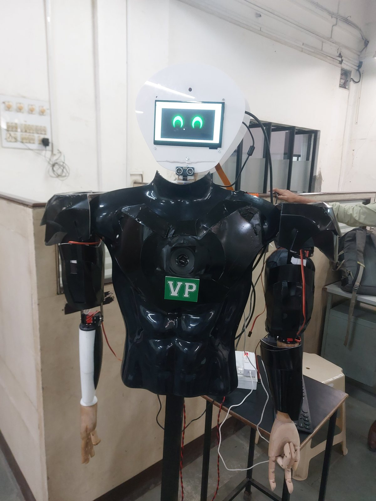
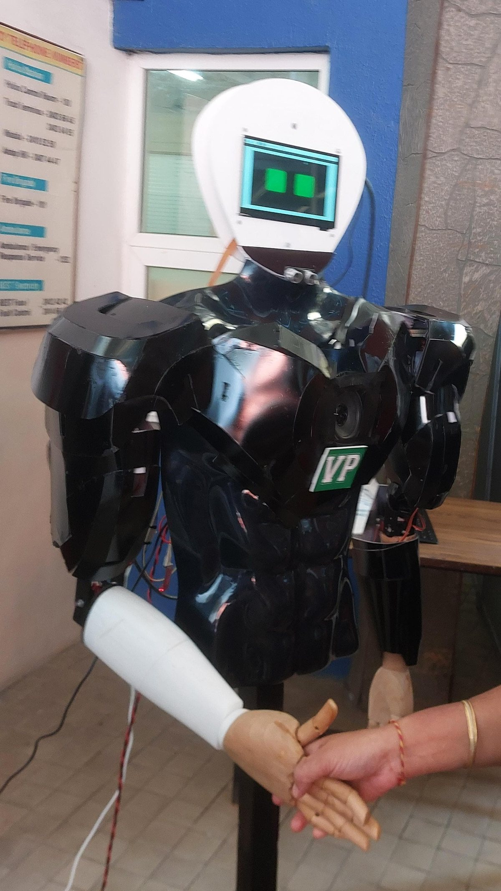

# Semi-Humanoid

Camera, hand-tracking and gesture-control stack for a semi-humanoid robot, built during a hackathon. A Raspberry Pi camera watches whoever is in front of the robot, MediaPipe tracks the hand, and finger states drive servos, a GlowBit matrix, keyboard shortcuts or speech.



The same gestures run the robot's hand servos and let it shake hands with a person:



## What is in here

| Path | What it does |
|---|---|
| `camtest.py` | Minimal Picamera2 check: preview, wait, capture `test.jpg` |
| `web/Simple-Hand-Tracker.py` | Draws the MediaPipe hand skeleton over the live feed |
| `web/Are Fingers up or Down.py` | Counts extended fingers and prints the states |
| `web/Are Fingers Up Servo Control.py` | Maps finger states to a 16-channel servo kit (the robot hand) |
| `web/GlowBit-Gesture-Control.py` | Drives a 4x4 GlowBit matrix from gestures |
| `web/Computer-Gesture-Control.py` | Turns gestures into keyboard shortcuts |
| `web/module.py` | Shared MediaPipe helpers plus gTTS speech output |
| `picamera2/` | Vendored Picamera2 checkout used on the Pi (BSD-2-Clause) |
| `images/` | Robot photos |
| `test.jpg` | Sample frame captured with `camtest.py` |

## Hardware

- Raspberry Pi 4 or 5 with a Camera Module
- 16-channel servo HAT (`adafruit_servokit`) for the hand and arm servos
- Pimoroni GlowBit 4x4 matrix
- Speaker for the text-to-speech replies
- The semi-humanoid torso and head shell with its display face and camera mount

## Setup

On Raspberry Pi OS, Picamera2 and OpenCV come from apt:

```sh
sudo apt install -y python3-picamera2 python3-opencv mpg321
pip install "mediapipe<0.11" gtts adafruit-circuitpython-servokit keyboard
```

For the GlowBit matrix:

```sh
pip install glowbit
```

The `picamera2/` directory is a full checkout of the library, kept so the Pi setup can be reproduced offline. It is not imported by the scripts below; on Raspberry Pi OS the system package is the one that gets used.

## Running

```sh
python camtest.py                              # camera check, writes test.jpg
python "web/Simple-Hand-Tracker.py"            # hand skeleton
python "web/Are Fingers up or Down.py"         # finger counting
python "web/Are Fingers Up Servo Control.py"   # gestures to servos
```

Run the `web/` scripts from inside `web/`, or add that folder to `PYTHONPATH`, because they import `module.py` by name.

## Notes

- Every script opens `cv2.VideoCapture(0)`. Change the index if the camera enumerates differently, and uncomment the `cv2.flip` line if it is mounted upside down.
- `camtest.py` uses `Preview.QTGL`, so run it on a desktop session or over VNC. Swap in `Preview.NULL` for a headless capture.
- `module.py` speaks through `mpg321` and writes `audio.mp3` into the working directory.
- Servo map in `Are Fingers Up Servo Control.py`: `0` index, `1` thumb, `2` ring, `3` pinky, `4` middle.
- The MediaPipe examples use the legacy `mediapipe.solutions` API.

## License

MIT. `picamera2/` keeps its own BSD-2-Clause license.
